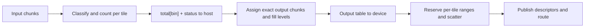

<!-- SPDX-FileCopyrightText: 2026 René Widera -->
<!-- SPDX-License-Identifier: MPL-2.0 -->

# graphFlow: asynchronous chunk-scheduling graph on alpaka3

## 0. Status and decisions

This document replaces the earlier graphFlow draft. The implementation starts from a **fresh repository with new history**. The prior [`psychocoderHPC-bot/graph`](https://github.com/psychocoderHPC-bot/graph) repository is reference material only: its runtime, scheduler, ABI, RNG, atomics, and warp-pool code are not ported. Its particle semantics, test vectors, and recorded limitations inform this design.

| Topic | Decision |
| --- | --- |
| Repository | Fresh `graphFlow` repository, new history, GitHub Actions |
| Deliverable | Reusable graph library plus `graphFlow_particle_feedback` example |
| Backends | CPU, NVIDIA CUDA on hal/A30, AMD HIP on an AMD runner |
| Large-bin path | Dense shared table, plus shared-memory open-addressing hash |
| Output planning | Host round trip per classify batch |
| Determinism | Histogram multiset equality across chunk size, backend, and scheduling order |
| Scale gate | CI smoke `N=1e6`; manual acceptance `N=1e8` |
| Hardware | hal A30 for CUDA; named AMD GPU for HIP |
| T13 integrated benchmark | Done. The A30 matrix was recorded on integrated main `68124ad3875e42cbe09247f64bd218a7ac8d58fc`: `N=1e8`, `C=8192`, `P=16128`, Q=1/Q=2/Q=8 wall 218.87 s / 9.83 s / 8.50 s on hal A30, identical histograms across Q, CPU/CUDA rows equal at `N=1e5`/`N=1e6`. T13 and T14a are in the historical FrameSpec rebase base `cb0548cedf81a284e6291a39dee1eeca7256d783`. |
| FrameSpec launch | Done: `launchPolicy` emits `FrameSpec{numFrames, frameExtent}` with `frameCap` default 8, host extent 1, and accelerator extent `T`; blocks stride the tile list. Current CTest: 82/82 CPU on fwk394, 86/86 CUDA on hal. |

**Goals**

- Host-scheduled dataflow graph with typed alpaka kernels.
- One asynchronous queue per graph node, with queue-independence probing and a sequential fallback.
- Chunked ownership with bounded working set independent of the total particle count.
- Generic multi-bin classify, exact output slot assignment, and scatter.
- Particle-feedback example with key-based Philox decisions and a reproducible histogram.
- Portable C++20 against the public alpaka3 API.

**Non-goals for v1**

- Device-persistent scheduler, device function pointers, cooperative launch.
- System-scope atomics, custom warp barriers, single-wave/co-residency assumptions.
- Join, broadcast, or multi-owner chunks. Each particle follows exactly one route per node.
- Runtime graph mutation during execution, multi-GPU, fault tolerance, and stable output order.

## 1. Why the prior design does not scale

The prior repository runs one persistent kernel for the pool lifetime, one hardware warp per packet, and indirect device-function calls. Its own design and limitation documents record the consequences:

- The grid is sized to one resident wave and validated by occupancy arithmetic plus a rendezvous. It cannot grow beyond that wave.
- User functors are compiled into the persistent kernel. Their register use lowers occupancy and changes the admissible wave.
- Every packet is processed by one warp through an indirect call. There is no per-node parallelism and no ordinary kernel launch to use all SMs.
- Cross-system publication needs system-scope atomics and custom warp barriers. Multi-warp blocks are refused because no validated warp-local barrier exists.
- `warp::shfl` uses `__activemask()` and does not reconverge a warp after a leader-only region. Control values must move through shared memory and `syncBlockThreads`.
- Pageable host copies block the stream; mapped pinned staging is mandatory for overlap.
- A separate copy queue is needed because the worker queue is occupied for the whole run.

The new design removes all of those constraints. Ordinary typed kernels can use the full device. The host owns topology, readiness, admission, and completion. Device-side state is limited to per-tile histogram, hash, and scatter work.

## 2. Mandatory alpaka3-first procedure

Every accelerator helper, kernel primitive, and test fixture must be checked against the pinned alpaka3 checkout before implementation.

1. Search `include/alpaka`, `example`, `test`, `docs/snippets`, and `docs/source` by operation and likely API name.
2. Read the implementation contract and at least one usage or test. Use the pinned source when documentation describes a different revision.
3. Prefer a public alpaka operation or a composition of public primitives. Do not reproduce a library feature in a project wrapper. A wrapper may encode a graph-specific policy, such as the mapping from particle ID to a Philox offset.
4. Compile a minimal probe on CPU, CUDA, and HIP when semantics, overloads, ordering, or support are unclear.
5. Record the result in `docs/alpaka-api-map.md`: operation, searched symbols, pinned path, selected API, tested backends, and reason for any project implementation.
6. Code review rejects redundant RNG, arithmetic, indexing, synchronization, memory, launch, or copy code when a suitable upstream primitive exists.

### Verified alpaka3 surface

| Capability | Verified surface | graphFlow use |
| --- | --- | --- |
| Queue creation | `onHost/Device.hpp:85-131`; `device.makeQueue(queueKind::nonBlocking)`; non-blocking is the default. CUDA/HIP create native non-blocking streams (`api/unifiedCudaHip/Queue.hpp:110`). **Independence is not guaranteed.** | One queue per node; probe independence; fall back to fair sequential submission. |
| Events | `onHost/Queue.hpp:122-127,245-270`; `onHost/Event.hpp:99-138`; `queue.makeEvent`, `queue.enqueue(event)`, `event.isComplete()`, `queue.waitFor(event)`, `onHost::wait`, `getElapsedTime`. | Per-batch completion records; timing only in benchmarks. |
| Host tasks | `onHost/Queue.hpp:177-217`; host callbacks share a backend callback thread and must not block; deferred tasks are not covered by `wait()`. | The scheduler polls events on its own thread; it does not use host callbacks. |
| Memory | `onHost/Device.hpp:215-320`; `onHost/Queue.hpp:309-453`; `alloc`, `allocLike`, `allocHost`, `allocMapped`, `allocUnified`, `allocDeferred`, `memcpy`, `memset`, `fill`; `SharedBuffer`/`keepAlive`. | Preallocated pools; `allocMapped` for asynchronous staging. |
| Launch | `onHost/FrameSpec.hpp`, `core/LaunchPolicy.hpp`, `KernelBundle.hpp`, `exec::anyExecutor`, `ALPAKA_FN_ACC`. | Frame-strided typed kernels; `numFrames = min(ceil(work/T), maxBlocksPerGrid, frameCap*multiProcessorCount)`. |
| Atomics | `onAcc/atomic.hpp:25-66`; `scope::Block` and `scope::Device`; `scope::System` is rejected by `static_assert`. | Histogram counters, `next[bin]`, hash insertion. |
| Shared memory | `onAcc/Acc.hpp:132-200`; `declareSharedVar`, `declareSharedMdArray`, `getDynSharedMem`, `syncBlockThreads`. | Per-tile dense or hash table; runtime size via dynamic shared memory. |
| Warp and intrinsics | `onAcc/warp.hpp:32-131`; `ballot`, `any`, `all`, `activemask`, `shfl*`, `getSize`; `intrinsic.hpp:17-46`; `popcount`, `ffs`, `clz`. | Ballot/popcount only where measured; no `shfl` for control decisions. |
| In-kernel scan/sort | **Absent.** `onHost/algo/scan.hpp`, `reduce.hpp`, `transform.hpp` enqueue kernels; they are not in-kernel collectives. | Dense/hash tables avoid a scan. Any future scan is project code. |
| RNG | `rand/engine/philox/philox.hpp:31-75`; `rand/distribution/UniformReal.hpp`, `NormalReal.hpp`. The constructor `offset` path is **broken** in the pinned tree: `skip4` uses wrong carry operands and the remainder is discarded. graphFlow packs `(id, event, purpose)` into the engine key and constructs at subsequence and offset zero. | Key-based engines and alpaka distributions for both examples. |
| Device properties | `onHost/DeviceProperties.hpp:43-56`; `multiProcessorCount`, `warpSize`, `sharedMemPerBlockBytes`, `maxThreadsPerBlock`, `maxBlocksPerGrid`. No occupancy API. | Chunk-size heuristic; no single-wave assumption. |
| Graph/DAG/scheduler | **Absent** in alpaka3. | Project-owned. |
| Views | `mem/MdSpan.hpp:228-236`; `mem/View.hpp:201-291`; `getExtents`, `getPitches`, `getSubView`. | Non-owning typed payload views. |

Pinned dependency: use the current alpaka3 `dev_v3.x` checkout and record its **exact commit** in `docs/build.md` and the acceptance record. Do not reuse the prior repository's `4780dc...` pin unless it matches the validated tree.

## 3. Repository layout

```text
graphFlow/
  CMakeLists.txt
  cmake/
  include/graphFlow/
    core/        Chunk.hpp, ChunkPool.hpp, Handle.hpp, Config.hpp
    sched/       Scheduler.hpp, Batch.hpp, EventPool.hpp, Admission.hpp
    graph/       Node.hpp, Graph.hpp, Classifier.hpp, Routing.hpp
    algo/        Histogram.hpp, BinTable.hpp, Multiplex.hpp
    rng/         ParticleRng.hpp
    detail/      Staging.hpp, Capabilities.hpp, QueueProbe.hpp
  examples/particle_feedback/
  tests/unit/
  tests/integration/
  tests/reference/
  docs/
  LICENSES/
```

CMake project `graphFlow`, library target `graphFlow`, example target `graphFlow_particle_feedback`, test target `graphFlow_tests`.

Options:

- `GRAPHFLOW_ENABLE_CUDA` (default `OFF`)
- `GRAPHFLOW_ENABLE_HIP` (default `OFF`)
- `GRAPHFLOW_ENABLE_OPENMP` (default `ON` when found)
- `GRAPHFLOW_BUILD_TESTS`, `GRAPHFLOW_BUILD_EXAMPLES`
- `GRAPHFLOW_ALPAKA_SOURCE_DIR`, `GRAPHFLOW_ALPAKA_GIT_TAG`
- `GRAPHFLOW_CATCH2_SOURCE_DIR`

Use `FetchContent` for alpaka and Catch2 at recorded pins, with local source overrides for offline builds. License project-owned code under MPL-2.0 with SPDX headers and REUSE compliance.

## 4. Data model

### 4.1 Chunk and handle

- A **chunk handle** is `{chunkIndex, generation}`. `generation` detects stale references after reuse.
- A **chunk descriptor** is `{handle, capacity C, fillLevel, bin, payload views, metadata views}`.
- Require `0 <= fillLevel <= C`. Publish only nonempty descriptors. Bound every read and write by `fillLevel`.
- Particle slots are stored in fixed-size chunks: particle `i` of chunk `k` lives at `k*C + i`. SoA fields are contiguous arrays of `numChunks*C` elements.
- Keep the generation until every asynchronous reference has retired.

### 4.2 Pools

- Preallocate a pool of `S` chunks, each with capacity `C`.
- Maintain a host free list of chunk indices. No hot-path allocation.
- Preallocate per-chunk metadata: bin IDs (one `uint32` per particle slot), plus optional rank if measured useful.
- Preallocate `K` batch records and `K` mapped staging buffers, each large enough for `total[maxBins]`, `next[maxBins]`, status, and the output table.
- The result buffer for the example is `N` weights indexed by particle ID. It is `O(N)` by definition and is counted separately from the scheduler working set.

### 4.3 Reservation and admission

Work in **chunk credits**, not particle slots. For an input batch with `n > 0` particles, capacity `C`, and at most `B` bins, reserve at most

```text
R = min(n, ceil(n/C) + min(B, n) - 1)
```

output chunks. For `n = 0`, reserve zero. Compute this in checked integer arithmetic.

Provision `S >= P + K*R` chunks, where `P` is the configured **source-admission capacity in live particles** and `K` is the maximum number of live transform batches. The `P` term is the worst-case number of live chunks under split routing: a bin with one particle still occupies a whole chunk, so feedback can fragment the live particles into one chunk each. A `ceil(P/C)` input budget is not sufficient. The pool therefore holds up to `P` input chunks plus `K*R` output-credit chunks. Source admission must be gated by the live-chunk budget `P`, never by the raw free-list length, so ready input chunks cannot consume the output-credit reserve. A pool sized from `N` instead of `P` eventually deadlocks; a pool sized `ceil(P/C)` deadlocks when bins fragment. The cost is up to `S*C` particle slots, so choose `P` and `C` against the memory budget and document the fragmentation overhead. A future slot-based pool can remove the `C-1` wasted slots per fragment.

Before a transform launch, charge its maximum `R` output chunks. After the histogram returns, allocate the exact `sum_b ceil(total_b/C)` chunks, release the surplus, and hold the exact leases through scatter. Retire input ownership at commit and release admission credits at the sink.

This bound is deliberately conservative. Keep `P`, `K`, and `C` in one configuration object, validate the arithmetic at construction, and reject configurations whose worst-case reservation does not fit. Add a regression test that runs with `N >> P`, a deliberately small `P`, and feedback enabled, and asserts completion, bounded pool use, and no stall.

## 5. Node and graph contracts

- `NodeBase` is a host-only interface: `submit`, `poll`, `complete`, `retire`. It may use virtual functions; kernels are typed inside each node. No device function pointers.
- A node has a typed input/output payload contract, a routing table, a host ready list, and one non-blocking alpaka queue.
- A **classifier** exposes `static constexpr std::uint32_t maxBins` and returns an integral bin in `[0, maxBins)`. Reject `maxBins == 0`. Require a routing entry for every valid bin. Check invalid IDs before indexing and surface the batch error before publishing.
- Kernel functors are named C++20 structs with `ALPAKA_FN_ACC`. They are pure with respect to their input chunk; outputs go to separate output chunks. No allocation, exceptions, or undeclared block barriers.
- Initial ownership is single-route. A node may route different particles to different outputs. Several bins may route to the same node; the chunk retains its bin identity. Join and broadcast need an explicit ownership extension later.
- A source node produces chunks; a transform node classifies and routes; a sink node consumes and writes results. A compute-only node may skip the histogram phase.
- The graph topology is host data built before the run. No mutation during execution.

Recommended state machine:

```text
Source:     Ready -> GenerateInFlight -> Generated -> Routed
Transform:  Ready -> ClassifyInFlight -> HistogramReady -> ScatterInFlight -> Retired
Compute:    Ready -> ComputeInFlight -> Retired
Sink:       Ready -> SinkInFlight -> Retired
```

Every completion is processed exactly once. A batch owns its input leases, output leases, staging handle, event, and error word. Recycle the event and staging only after the last consumer retires.

## 6. Execution pipeline



### 6.1 Classify

- Blocks stride over the batch tile list; each tile owns `T` particles and `T` is
  chosen independently of `C`.
- All threads participate in barriers, including inactive lanes in a tail tile.
- Apply the classifier once per particle and store the bin ID in the chunk metadata.
- Dense path: per-block shared `counts[B]`, zero, barrier, block-scope `atomicAdd`, barrier, global device-scope `atomicAdd(total[bin], count)` for each nonempty bin.
- Hash path: per-block shared open-addressing table for observed bins (Section 7).
- Zero `next[bin]` before scatter, on the same queue.
- Copy `total[maxBins]` and the status word to the host through an `allocMapped` staging buffer. Enqueue the completion event after the copy.

### 6.2 Host planning

- For each bin with `total > 0`, allocate `ceil(total/C)` chunks from the batch's credits.
- Build a flat output-chunk list and a per-bin base index. Slot `i` of a bin has `fillLevel = min(C, total - i*C)`.
- There is no persistent open pair of chunks per bin. Partial chunks are immediately routable after scatter.
- Copy the output table to a per-batch device buffer on the same queue, then launch scatter. The table contains per-bin base indices into the flat chunk list; the flat list contains chunk indices.
- Check conservation and overflow in debug and test builds.

### 6.3 Scatter

- Blocks stride over the batch input tiles.
- Rebuild the per-tile bin counts from the stored bin IDs. This avoids recomputing the classifier.
- For each nonempty tile/bin group, reserve one device-scope range:

```text
base[bin] = atomicAdd(next[bin], countInTile[bin], device)
j         = base[bin] + rankWithinTileBin
chunk     = outputChunks[binChunkBase[bin] + j / C]
offset    = j % C
```

- The ranges within a bin are disjoint. A range may cross one or more chunk boundaries.
- `next[bin] == total[bin]` after scatter completion; verify in validation builds.
- Ordering between tiles in a bin is unspecified. Compare output by histogram multiset or by particle ID.
- Publish output descriptors only after the scatter event completes and the required metadata is host-visible.

Start with direct SoA scatter. Benchmark an alternative that stages one field or a bounded field group through shared memory and writes in grouped bin order. Keep the direct path as the correctness reference.

## 7. Large-bin hash path

Use the dense path when `3 * B * sizeof(uint32_t)` fits inside a configured fraction of `sharedMemPerBlockBytes`. Use the hash path above that threshold.

- Shared table sized to the next power of two of `2*T` or `4*T`, as measured.
- Entry: `{uint32_t key, uint32_t count, uint32_t base, uint32_t localRank}`. Key `0xFFFFFFFF` is empty.
- Insert with `atomicCAS` on the key; on a matching key, `atomicAdd` the count; otherwise probe linearly.
- Barrier after insertion. Each thread iterates a strided slice of the table; for every occupied entry, reserve `base = atomicAdd(next[bin], count, device)` and reset `localRank = 0`.
- Barrier. Each particle looks up its bin and obtains `rank = atomicAdd(localRank, 1, block)`, then computes `j = base + rank`.
- A full table is a hard batch error. The kernel writes a status word; the host aborts and does not publish partial output.
- Do not require a sort or scan. If a future stable grouping is needed, implement it as a separate measured variant.
- Compare dense and hash paths at overlapping `B`, and keep the threshold measurement-driven.

The optional ballot/popcount optimization is only for small dense bins. It must use `warp::getSize(acc)` and the 32- or 64-bit ballot type; do not hardcode 32.

## 8. Scheduler and forward progress

### 8.1 Host loop

```text
loop:
    retire completed batch events
    plan output chunks for completed histograms
    publish completed output descriptors and release finished inputs
    schedule eligible continuations and downstream ready batches
    admit new source chunks if in-flight and storage budgets permit
    finish when sources are exhausted and all ready/in-flight state is empty
    back off if no progress was possible
```

- Use a single host scheduler thread. It owns queue submissions, routing, event retirement, free lists, staging, and admission.
- Poll `event.isComplete()` with bounded spin then `std::this_thread::yield()`. Do not block on `queue.waitFor()` in the steady state.
- Bound each node's submitted depth. Use fair round-robin across nodes. Prioritize continuations and sinks that release storage under pressure.
- Combine already-ready chunks of the same type to amortize launches. Dispatch partial chunks immediately; there is no full-chunk threshold.
- Source admission is not a free-running producer. Admit a source chunk only when it can carry at least `min(C, P, remaining)` particles; otherwise wait for the sink to release budget. One-particle source chunks fill the pool, fragment the graph, and turn every particle into a separate host round trip. The no-full-chunk-threshold rule applies to consumer ready lists, not to source generation. A tail chunk (`remaining < C`) or a deliberately small `P` still gets a smaller chunk.
- Never place an unfinished dependency ahead of ready work in a node's FIFO queue.

### 8.2 Queue independence

`device.makeQueue()` may return the same handle and does not guarantee parallel execution. Therefore:

- Run a startup probe with two queues, two short kernels, and two events. Record whether the second kernel overlaps the first.
- Correctness never depends on overlap. If queues alias, submit in fair round-robin order and rely on FIFO ordering.
- Keep the number of active node queues bounded and configurable.
- Do not use `enqueueHostFn` for scheduler callbacks. Host callbacks share a backend thread and must not block.

### 8.3 Completion and termination

- A completion event follows the last operation it covers, including the metadata copy to the host.
- Use a separate completion record per live batch. Recycle its event and staging only after all consumers retire.
- Publish descriptors only when producer work and metadata copies are complete. Return input chunks to the pool only after their last device access.
- If multiple queues read an input, retire its lease after every recorded reader finishes. The v1 route is single-owner, so this is one reader.
- Terminate only when sources are exhausted or closed, no ready work remains, no metadata callbacks are pending, no kernels or copies are in flight, and no reservations remain.
- Feedback may create new work after a source closes. The termination check must cover feedback-ready work.

### 8.4 Errors

- Each batch carries a status/error word written by device code.
- Invalid classifier result, hash-table full, count overflow, and weight overflow are hard errors.
- Abort the batch, release its leases, stop admission, drain in-flight work, and return a nonzero exit status.
- Catch asynchronous enqueue and wait failures. Keep allocations alive through their last device use.
- Add test timeouts and a scheduler state dump for stall diagnosis.

## 9. Particle-feedback example

Build `graphFlow_particle_feedback` under `examples/particle_feedback/`.

CLI: `--backend cpu|cuda|hip --particles N --chunk-size C --seed S --max-visits M --device D`.

- Accept `N = 0`; reject `C = 0`; support capacities that are not warp multiples.
- Default `C` from the device: `multiProcessorCount * targetBlocksPerSm * T`, capped by memory and `maxBlocksPerGrid`. Print the chosen policy.
- `--max-visits` guards pathological feedback; on exceed, route to the sink and report a non-terminating count.

### 9.1 Particle semantics

Fields: `id: uint64`, `property: uint32`, `weight: uint32`, `visit: uint32`. All decisions are integer-only.

```text
Generate: property = draw(seed, id, visit=0, Property)
Filter:   draw(seed, id, visit, Filter) >= property ? Bin 1 : Bin 0
ProcessA: draw(seed, id, visit, DecisionA) >= 2^31
          ? weight += 1000, visit += 1, feedback to Filter
          : sink with unchanged weight
ProcessB: draw(seed, id, visit, DecisionB) >= 2^31
          ? weight += 1, visit += 1, feedback to Filter
          : sink with unchanged weight
Sink:     result[id] = weight
```

Use checked 32-bit weight addition; overflow is a hard error. The filter preserves `property`. Functors read the input chunk and write a separate output chunk, so a retry cannot double-apply a mutation.

### 9.2 RNG

Use the public `alpaka::rand::engine::Philox4x32x10`.

- Constructor: `Philox4x32x10(seed, subsequence = particleId, offset)`.
- The pinned `Philox4x32x10` constructor `offset` path is **broken**. `skip4` compares the wrong carry operands, and `offset % 4` is discarded, so `Philox4x32x10(seed, id, k)` is not equivalent to advancing a fresh engine `k` times. Do not pass the stream index as the constructor offset.
- Initialise one engine per logical `(id, event, purpose)` from a bijective packed key and construct it at subsequence and offset zero. Flow injects the engine into opting-in functors; the particle property, Filter, A, and B use distinct stage purposes. Floating-point draws use the alpaka distributions. This is portable, self-consistent, and uses only the public engine.
- Record the upstream defect with its minimal reproduction in `docs/alpaka-api-map.md` and report it upstream. Verify the workaround with a host probe and on CPU, CUDA, and HIP.
- Draw positions must not depend on chunk, tile, thread, or scheduling order. The advance cost is small for the bounded per-visit indices in this example; measure it before using larger offsets.
- Do not implement SplitMix or another graph-local RNG. The prior repository's SplitMix is not carried over.

### 9.3 Acceptance contract

Acceptance is the **sorted sparse histogram** of final weights: rows `weight,count`, strictly increasing weights, positive counts, and counts summing to `N`. Per-particle checks are diagnostic, not a gate, because the contract is multiset equality.

A small scripted fixture exercises the production routing without Philox:

| Particle ID | Scripted visits | Final weight |
| --- | --- | ---: |
| 0 | A stops | 0 |
| 1 | A survives, B stops | 1000 |
| 2 | B survives, B stops | 1 |
| 3 | A survives, B survives, A stops | 1001 |

Expected rows: `0,1`, `1,1`, `1000,1`, `1001,1`. Run with chunk capacities 1 and 3 to exercise feedback and partial chunks.

Build the host histogram by sorting the result buffer with a host radix sort for `N=1e8`, or `std::sort` for CI sizes, then run-length encode. Record the sort cost separately.

## 10. Performance and scale

### 10.1 Measurement

Record:

- End-to-end particles per second, wall time, and total kernel launches.
- Classify and scatter time, host round-trip latency, and device idle time.
- Effective scatter bandwidth using logical payload bytes read and written.
- Peak live chunks, peak reserved chunks, and staging use.
- Queue overlap from the startup probe and from a steady-state timeline.
- Dense versus hash path at overlapping bin counts.
- Direct SoA scatter versus shared-staging scatter.
- One, two, and four waves of chunk capacity.
- Balanced, one-hot, skewed, and many-sparse-bin distributions.

### 10.2 Scale gates

- CI smoke: `N=1e6` on CPU, CUDA, and HIP.
- Manual acceptance: `N=1e8` on hal/A30 and on the AMD runner.
- Working set must stay bounded by `S*C` and `K*R`, independent of `N`. Verify with `N >> P`.
- Record the first correct `N=1e8` throughput, then freeze it as a regression target with a stated tolerance. Do not invent a throughput number before the first measurement. The current baseline is about `5.33e5` particles/s on the shared A30; re-measure on an exclusive allocation before treating it as acceptance-grade.
- Report a sustained copy-bandwidth reference on the same device and data size as context.

T13 (integrated performance matrix) is done on integrated main
`68124ad3875e42cbe09247f64bd218a7ac8d58fc`: `N=1e8`, `C=8192`, `P=16128` on
hal A30 took 218.87 s (Q=1), 9.83 s (Q=2), and 8.50 s (Q=8), with identical
histograms across Q and CPU/CUDA rows equal at `N=1e5` and `N=1e6`; the
shared-host caveat and the full table are in `docs/benchmarks.md` and
`docs/acceptance.md`.

Observed baseline on A30 (hal, sharing unknown), with `C=8192`, `P=65536`, and full-chunk source admission: `N=1e5` took 0.58 s, `N=1e6` took 2.24 s, and `N=1e8` took 187.5 s wall (about `5.33e5` particles/s). The `N=1e8` histogram summed to exactly 100,000,000 over 264 rows, with a peak of 877 live chunks in a 65542-chunk pool. The same `N=1e6` configuration with one-particle source admission took about 119 s and peaked at 8195 of 8198 chunks. The queue probe reported distinct queues but no overlap, so the speedup came from full-chunk pipelining, not cross-queue overlap. The `S=P+K*R` payload pool is about 12.9 GB at these settings while the observed peak is under 1000 chunks; a slot-based pool or a smaller `P` is the next memory optimization. At that baseline HIP was compile-only for `gfx90a`; the current HIP runtime validation is on `hal` with `gfx1100` (ROCm 7.2). Historically, ASAN and UBSAN passed 42/42 tests on hal; TSAN was blocked by the hal kernel's `unexpected memory mapping` limit, not by a project defect. These sanitizer results are from the pre-T5/T7 baseline record and are not an integrated ASAN/UBSAN result. Treat the throughput as a recorded baseline until an exclusive allocation is available.

## 11. Tests and CI

### 11.1 Test matrix

| Area | Required checks |
| --- | --- |
| Pool and handles | Exhaustion, deferred reclamation, generation reuse, no premature reuse, reservation arithmetic, bounded memory, backpressure. |
| Scheduler | Independent nodes, producer-to-consumer visibility, one queue per node, ready work bypassing unresolved dependencies, fair progress, small-batch dispatch, termination without device-wide waits, queue-alias fallback. |
| Dense bins | `B = 1, 2, 3, 64, 1024`; sparse IDs, empty bins, multiple bins to one node, invalid classifier results, hot-bin stress. |
| Hash bins | `B = 4096, 65536`; sparse distribution, table-full error, dense/hash agreement at overlapping `B`, no hardcoded warp size. |
| Multiplexer | No overlapping reservations, exact routing and counts, input conservation, chunk-boundary crossings, exact and partial fills, batched inputs, counter overflow, output visibility only after completion, scalar partition oracle. |
| Example | `N = 0, 1, 17, 127, 128, 4097, 1e6`; `C = 1, 31, 127, 128`; `T = 32, 128`; `frameCap = 1, 8, uncapped`; `Q = 1, 2, 8`; seeds `0, 7, 42`; feedback, max-visits, histogram conservation, CPU/CUDA/HIP multiset equality. |
| API reuse | Compile and run the selected Philox, event, `allocMapped`, atomic, shared-memory, and warp paths on all three backends; every helper has an API-map entry. |
| Sanitizers | ASAN/UBSAN for host code; TSAN for the scheduler; leak checks. |

### 11.2 CTest smoke cases

Seed 42 for the fixed cases. The harness checks the histogram header, strictly increasing weights, positive row counts, and counts summing to `N`. For fixed seeds, compare the sorted rows to the scalar oracle.

| Case | N | C | Coverage |
| --- | ---: | ---: | --- |
| Empty | 0 | 128 | Immediate drain, no data rows |
| Single | 1 | 1 | Minimal capacity, exactly-once sink |
| Partial | 17 | 127 | Partial source chunk, non-warp capacity |
| Exact | 128 | 128 | Exact chunk capacity |
| Multiple | 4097 | 128 | Multiple chunks, feedback, final tail |

Also compare the same `(N, seed)` across capacities 31 and 128 and across CPU, CUDA, and HIP.

### 11.3 CI

GitHub Actions jobs:

- `cpu`: Ubuntu, Release and Debug, CTest with JUnit, `--no-tests=error`.
- `format`: clang-format 20.1.8, `reuse lint` 6.3.0.
- `sanitizers`: ASAN/UBSAN and TSAN on the host scheduler, with alpaka sanitizer suppressions.
- `cuda`: self-hosted hal/A30 runner, `CMAKE_CUDA_ARCHITECTURES=80`, `CUDA_VISIBLE_DEVICES=0`, environment scrub, no skipped tests.
- `hip`: self-hosted AMD runner, ROCm arch set to the runner GPU, `ROCR_VISIBLE_DEVICES=0`, no skipped tests.

GPU jobs must fail if a required test is skipped or if the requested backend did not run. Keep the JUnit reports and environment diagnostics.

## 12. Milestones and gates

| Milestone | Deliverable | Exit gate |
| --- | --- | --- |
| M0 Bootstrap | New repo, CMake, pins, API map skeleton, queue probe, CPU/CUDA/HIP smoke test. | Smoke kernels run on all three backends; probe result recorded. |
| M1 Core | Chunk pool, handles, generations, batch records, event pool, staging, scheduler skeleton, two typed test nodes. | Pool and scheduler unit tests pass; bounded in-flight; no leaks. |
| M2 Dense pipeline | Classify, host planning, exact output chunks, scatter, dense bins. | Scalar oracle matches for `B=1..64`; invalid bin aborts; no overlapping reservations. |
| M3 Hash pipeline | Shared-memory hash path above the dense threshold. | Sparse `B=1024..65536` passes; table-full error; dense/hash agreement. |
| M4 Graph and example | Graph API, routing, feedback, Philox, CLI, histogram. | `N=1e6` histogram matches on CPU/CUDA/HIP; scripted fixture passes. |
| M5 Pressure and robustness | Admission pressure, `N >> P`, termination, abort, error injection, timeouts, sanitizers. | No deadlock; errors surfaced; bounded memory; sanitizer clean. |
| M6 Scale, docs, CI | `N=1e8` on A30 and AMD, performance record, docs, CI, acceptance. | Throughput recorded and frozen; format/REUSE green; no skipped GPU tests. |

## 13. Risks and mitigations

| Risk | Mitigation |
| --- | --- |
| `makeQueue()` aliases queues | Startup probe; correctness independent of overlap; fair sequential fallback. |
| Host round-trip latency dominates | Pipeline multiple classify batches; measure before adding device-side planning. |
| Hash table full or collision-heavy | Size to `2*T`/`4*T`; hard error; measure threshold; dense fallback for small `B`. |
| Dynamic shared memory limit | Cap dense `B` by `sharedMemPerBlockBytes`; hash for large `B`; check dynamic shared bytes in the kernel trait. |
| HIP warp size 64 | Use `warp::getSize(acc)` and the ballot return type; no hardcoded 32. |
| Pageable staging blocks the queue | Use `onHost::allocMapped`; reject pageable staging in async paths. |
| `shfl` after divergent leader-only regions | Move control values through shared memory plus `syncBlockThreads`; use `shfl` only in uniform control flow. |
| No occupancy API | Chunk-size heuristic from `DeviceProperties`; no single-wave assumption; calibrate offline. |
| `O(N)` result buffer | Count it separately; `N=1e8` at 4 bytes per weight is 400 MB; document the limit. |
| Chunk fragmentation under split routing | Up to `P` live chunks, one per fragmented particle; size `S = P + K*R`, reduce `C`, or add a slot-based pool. |
| Event/staging pool exhaustion | Bound live batches `K`; backpressure; never recycle a live event. |
| GPU CI runners | Self-hosted labels and environment scrub; fail on skipped tests. |

## 14. Acceptance checklist

- Fresh repository builds CPU, CUDA, and HIP configurations with C++20.
- All three backends run the particle example; the requested backend is asserted.
- Histogram multisets match the reference for the full `N`, `C`, and seed matrix.
- `N=1e6` in CI; `N=1e8` manual acceptance on hal/A30 and the AMD runner.
- Working set bounded by the configured chunk pool and reservation credits, independent of `N`.
- Queue-overlap probe recorded; correctness does not depend on overlap.
- No deadlock under pressure; termination with feedback; errors surfaced; timeouts present.
- ASAN/UBSAN/TSAN clean for host scheduler paths.
- Format, REUSE, and documentation gates green.
- `docs/alpaka-api-map.md` contains an entry for every new accelerator helper.
- The prior persistent-pool runtime, system atomics, warp barrier, SplitMix RNG, and device function-pointer ABI are absent.

---

## Open items to confirm during implementation

- Record the exact alpaka3 commit and the AMD GPU model/ROCm version in the acceptance document.
- Calibrate the `N=1e8` throughput after M4/M6, then freeze the regression target.
- Decide whether joins/broadcast and device-side output planning are follow-on milestones or out of scope.
